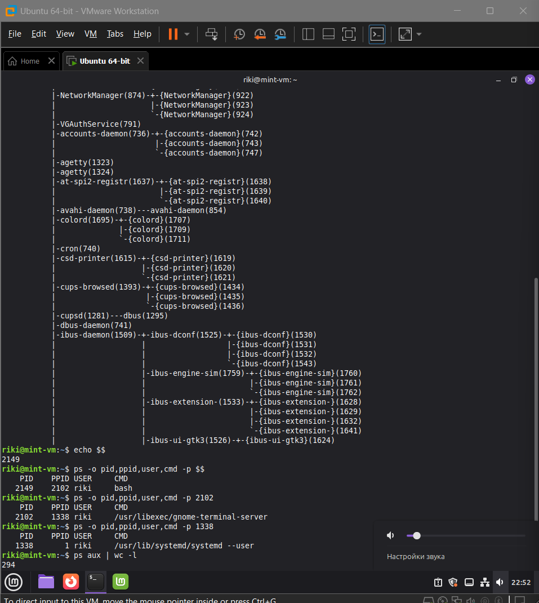

Здесь видно, как systemd порождает пользовательский экземпляр systemd, который запускает терминал, внутри которого работает моя оболочка bash, запустившая команду pstree

2. Цепочка от оболочки до PID 1

Я последовательно узнавал родительский процесс (PPID), подставляя его в команду ps -o pid,ppid,user,cmd -p <PPID>, пока не дошёл до PID 1.PID
PPID
Пользователь
Команда
2149
2102
riki
bash
2102
1338
riki
/usr/libexec/gnome-terminal-server
1338
1
riki /usr/lib/systemd/systemd --user
1
0
root
systemd (или init)

3. Ответы на контрольные вопросы

Какой процесс стоит в корне дерева и почему у него нет родителя? В корне дерева находится процесс systemd с PID 1. У него нет родителя (PPID = 0), потому что это самый первый пользовательский процесс, который запускает ядро Linux сразу после своей собственной инициализации. Все остальные процессы в системе являются его прямыми или косвенными потомками.
Сколько всего процессов работает в системе и почему большинство из них в состоянии S? Команда ps aux | wc -l показала 294 строки (что означает примерно 293 работающих процесса, так как одна строка — это заголовок). Большинство процессов находятся в состоянии S (Interruptible Sleep / прерываемый сон). Это нормальное и правильное поведение: процесс переходит в это состояние, когда ему нечего делать прямо сейчас, и он ждёт наступления какого-либо события (например, ввода-вывода с диска или сети, нажатия клавиш пользователем, истечения таймера или получения сигнала). В состоянии S процесс не потребляет процессорное время (CPU), что позволяет системе эффективно работать
