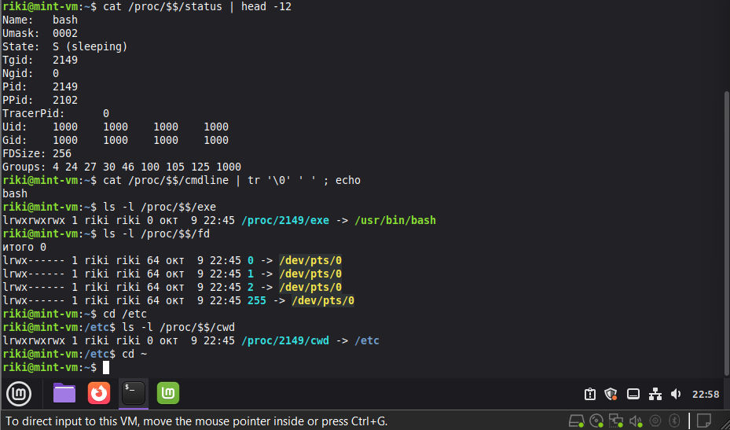

Задание 2. Паспорт процесса через /proc
 1. Таблица «Паспорт процесса
Я составил описание своей текущей оболочки (bash, PID 2149), используя только файлы из каталога /proc/$$:
| Параметр | Значение | Источник (файл в /proc) 
| Имя | bash | /proc/$$/status (Name) |
| PID | 2149 | /proc/$$/status (Pid) |
| PPID | 2102 | /proc/$$/status (PPid) |
| UID | 1000 | /proc/$$/status (Uid) |
| Состояние | S (sleeping) | /proc/$$/status (State) |
| Исполняемый файл | /usr/bin/bash | Символическая ссылка /proc/$$/exe |
| Текущий каталог | /home/riki (или /etc в момент проверки) | Символическая ссылка /proc/$$/cwd |

2. Дескрипторы файлов (0, 1, 2)

Команда ls -l /proc/$$/fd показала открытые файловые дескрипторы процесса:
``text lrwx------ 1 riki riki 64 окт  9 22:45 0 -> /dev/pts/0 lrwx------ 1 riki riki 64 окт  9 22:45 1 -> /dev/pts/0 lrwx------ 1 riki riki 64 окт  9 22:45 2 -> /dev/pts/0 lrwx------ 1 riki riki 64 окт  9 22:45 255 -> /dev/pts/0 **Объяснение:** **0 (stdin)**: Стандартный ввод. Указывает на /dev/pts/0 (мой псевдотерминал), откуда процесс читает команды, которые я печатаю. **1 (stdout)**: Стандартный вывод. Указывает на тот же терминал, куда процесс отправляет нормальный результат выполнения команд. **2 (stderr)**: Стандартный поток ошибок. Также указывает на терминал, чтобы сообщения об ошибках были видны пользователю. __(255 — это внутренний дескриптор, который bash использует для управления самой сессией терминала).__ **3. Изменение текущего каталога (cwd)** Когда я выполнил команду cd /etc, а затем проверил ls -l /proc/$$/cwd, вывод изменился:lrwxrwxrwx 1 riki riki 0 окт  9 22:45 /proc/2149/cwd -> /etc **Почему это произошло:** Файл cwd в каталоге /proc — это не обычная копия данных, а **динамическая символическая ссылка**, которая ядро обновляет в реальном времени. Когда процесс (в данном случае моя оболочка bash) меняет свой рабочий каталог, ядро мгновенно обновляет эту ссылку. Поэтому ps или ls всегда показывают актуальное состояние. **4. Почему ps и top показывают те же сведения, что и /proc?** Потому что утилиты ps, top и htop **не имеют собственного источника информации** о процессах. Они являются всего лишь удобными «читателями» (парсерами), которые берут сырые данные напрямую из файлов виртуальной файловой системы /proc (например, /proc/[pid]/status, /proc/[pid]/stat, /proc/[pid]/cmdline) и форматируют их в удобные для человека таблицы. /proc` — это единственный источник истины о процессах в Linux.
