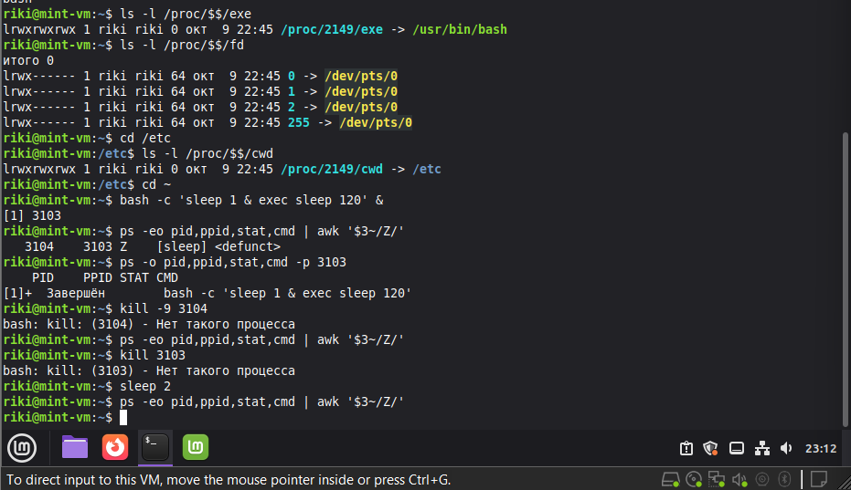

 Задание 3. Зомби-процесс своими руками
1. Создание и поиск зомби
Я запустил команду, которая создаёт родительский процесс, не ожидающий завершения своего потомка:
``bash bash -c 'sleep 1 & exec sleep 120' & После ожидания в 2-3 секунды я поискал процессы со статусом Z (Zombie): ps -eo pid,ppid,stat,cmd | awk '$3~/Z/' Вывод    3104    3103 Z    [sleep] <defunct> Мы видим процесс с PID 3104, его родитель (PPID) — 3103, статус Z и пометка <defunct>, что подтверждает его зомби-состояние.
2. Попытка «убить» зомби и исчезновение
 Я проверил состояние родителя:ps -o pid,ppid,stat,cmd -p 3103 Вывод ps -o pid,ppid,stat,cmd -p 3103 Родительский процесс уже завершился. Я попытался принудительно завершить сам зомби:kill -9 3104 Вывод bash: kill: (3104) - Нет такого процесса После этого повторная проверка ps -eo pid,ppid,stat,cmd | awk '$3~/Z/' не показала никаких зомби-процессов. **3. Ответы на контрольные вопросы** **Почему kill -9 не подействовал на зомби?** Сигналы (включая SIGKILL, он же kill -9) обрабатываются ядром и передаются живым процессам. Зомби-процесс уже завершил своё выполнение и не имеет исполняемого кода или контекста. Он существует только как запись в таблице процессов, ожидающая считывания статуса завершения родительским процессом. Посылать сигнал некому, поэтому ядро сообщает, что процесса не существует. **Почему зомби исчез после завершения родителя?** Когда родительский процесс (PID 3103) завершился, его дочерний зомби-процесс стал «сиротой». По правилам Linux, все процессы-сироты автоматически усыновляются процессом init (или systemd) с PID 1. Процесс init специально запрограммирован так, что он периодически вызывает системный вызов wait() для всех своих дочерних процессов. Как только init усыновил зомби, он мгновенно считал его статус завершения и удалил запись о нём из таблицы процессов. **Чем опасна ситуация, когда в системе тысячи зомби?** Хотя зомби не потребляют процессорное время (CPU) и оперативную память (RAM), каждый из них занимает одну ячейку в глобальной таблице процессов ядра. В системе существует лимит на максимальное количество процессов (параметр pid_max`, обычно 32768 или больше). Если зомби накопится слишком много, они исчерпают этот лимит, и система не сможет создавать новые процессы (включая новые оболочки, службы или команды), что приведёт к полному зависанию и неработоспособности ОС.
