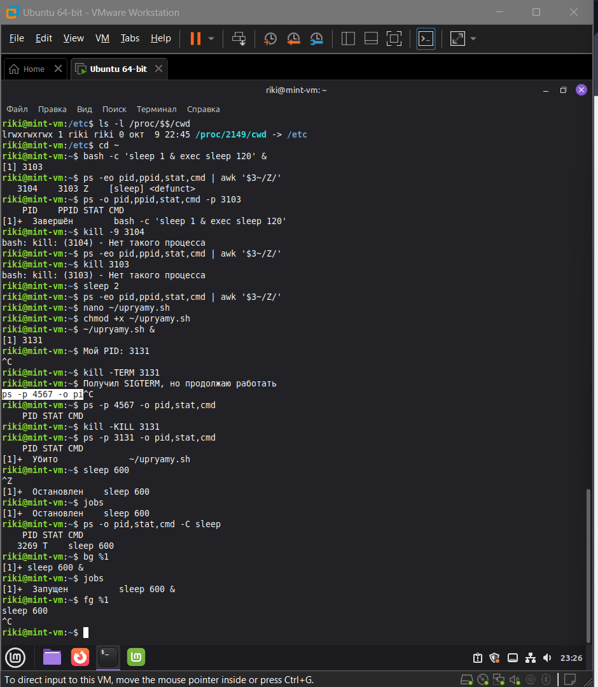

Задание 4. Сигналы: SIGTERM против SIGKILL
Часть А. Упрямый процесс
Я создал скрипт ~/upryamy.sh, который перехватывает сигнал SIGTERM с помощью команды trap. 
При отправке вежливого сигнала kill -TERM 3131 скрипт вывел сообщение "Получил SIGTERM, но продолжаю работать" и продолжил работу, так как он перехватил этот сигнал.
При отправке жёсткого сигнала kill -KILL 3131 процесс был немедленно уничтожен ядром (терминал вывел [1]+ Убито ~/upryamy.sh), и проверка ps показала, что процесса больше не существует.
Часть Б. Передний план и фон
Я запустил долгий процесс на переднем плане и перевёл его в фон, а затем вернул обратно.

Вывод команд:
``text riki@mint-vm:~$ sleep 600 ^Z [1]+  Остановлен    sleep 600 riki@mint-vm:~$ jobs [1]+  Остановлен    sleep 600 riki@mint-vm:~$ ps -o pid,stat,cmd -C sleep     PID STAT CMD    3269 T    sleep 600 riki@mint-vm:~$ bg %1 [1]+ sleep 600 & riki@mint-vm:~$ jobs [1]+  Запущен          sleep 600 & riki@mint-vm:~$ fg %1 sleep 600 ^C **Ответы на контрольные вопросы** **1. Почему скрипт пережил SIGTERM, но не пережил SIGKILL?** Сигнал SIGTERM (15) — это вежливая просьба завершиться. Процесс может перехватить его (как мы сделали через trap), проигнорировать или выполнить действия перед выходом (например, сохранить данные). Сигнал SIGKILL (9) обрабатывается напрямую ядром операционной системы. Его невозможно перехватить, заблокировать или проигнорировать на уровне пользовательского процесса — ядро просто немедленно уничтожает процесс. **2. Почему правильный порядок — сначала SIGTERM, и только потом SIGKILL?** SIGTERM даёт процессу возможность корректно завершить работу: закрыть открытые файлы, завершить сетевые соединения, сохранить состояние. Если сразу отправить SIGKILL, процесс умрёт мгновенно, не успев ничего сохранить. __Что может пострадать при немедленном kill -9 у базы данных?__ База данных может потерять несохранённые транзакции, оставить файлы блокировок (lock files), что помешает ей запуститься в следующий раз, или повредить индексы и файлы данных, потребовав длительного восстановления при следующем старте. **3. Какую букву состояния получил sleep после Ctrl+Z и что она означает?** После нажатия Ctrl+Z процесс получил состояние **T** (Stopped / Остановлен). Это означает, что выполнение процесса приостановлено ядром, он не потребляет процессорное время и ждёт сигнала для продолжения работы (например, SIGCONT, который отправляет команда bg или fg). **4. Какой сигнал посылает Ctrl+C, а какой — Ctrl+Z?** **Ctrl+C** посылает сигнал **SIGINT** (Signal Interrupt). Он прерывает выполнение процесса на переднем плане. **Ctrl+Z** посылает сигнал **SIGTSTP`** (Signal Terminal Stop). Он приостанавливает (замораживает) выполнение процесса и возвращает управление в оболочку.
