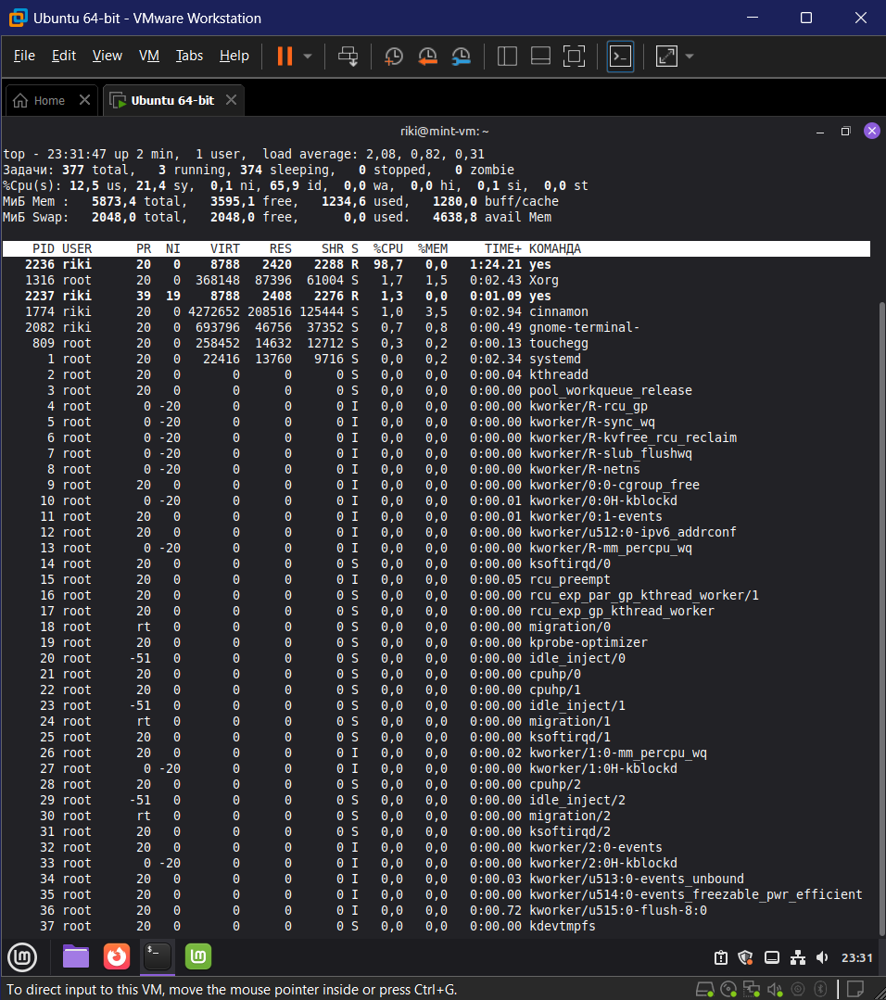
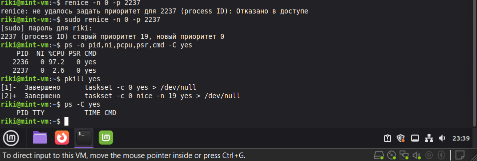

Задание 5. Приоритеты процессов

1. Запуск процессов и проверка приоритетов

Я узнал количество ядер (nproc) и запустил два процесса yes, нагружающих процессор, принудительно привязав их к одному ядру (ядро 0) с помощью taskset -c 0. Один процесс запущен с обычным приоритетом, второй — с пониженным (nice -n 19).

Проверка начального состояния:
``bash ps -o pid,ni,pcpu,psr,cmd -C yes **2. Изменение приоритета** Я попытался повысить приоритет второго процесса (с 19 до 0) обычной командой renice, но получил отказ:renice -n 0 -p 2237 # Вывод: renice: не удалось задать приоритет для 2237 (process ID): Отказано в доступе Затем я выполнил ту же команду с правами суперпользователя:sudo renice -n 0 -p 2237 Вывод 2237 (process ID) старый приоритет 19, новый приоритет 0 Проверка состояния после изменения: ps -o pid,ni,pcpu,psr,cmd -C yes Вывод     PID  NI %CPU PSR CMD    2236   0 97.2   0 yes    2237   0  2.6   0 yes Теперь оба процесса имеют приоритет NI = 0 и работают на одном ядре (PSR = 0), конкурируя за процессорное время. **3. Скриншот из top4. Ответы на контрольные вопросы** **Как распределился процессор между процессами с nice 0 и nice 19?** Пока у процессов были разные приоритеты (0 и 19), планировщик Linux отдавал почти всё процессорное время процессу с nice 0, а процесс с nice 19 получал лишь остаточные циклы. После выравнивания приоритетов (оба стали 0) они начали конкурировать на равных (хотя из-за инерции планировщика один мог временно доминировать, как видно по 97.2% и 2.6% в момент снимка). **Почему для повышения приоритета (уменьшения nice) потребовался sudo?** В Linux обычный пользователь имеет право только __понижать__ приоритет своих процессов (делать значение nice больше, вплоть до 19), чтобы быть «вежливее» к другим пользователям системы. __Повышать__ приоритет (уменьшать nice ниже 0 или возвращать к 0) может только суперпользователь (root). Это защита от того, чтобы обычный пользователь не захватил все ресурсы CPU в ущерб системе и другим пользователям. **Зачем понадобилась команда taskset -c 0?** Если у виртуальной машины несколько ядер (например, 2), планировщик по умолчанию может запустить каждый из двух процессов yes на отдельном ядре. В этом случае они не будут конкурировать за ресурсы, и оба покажут загрузку ~100%, из-за чего разница в приоритетах (nice) будет незаметна. taskset -c 0 принудительно привязывает оба процесса к одному и тому же ядру, заставляя их реально соревноваться за процессорное время. **5. Завершение процессов** После завершения экспериментов я принудительно завершил все процессы yes`, чтобы снять нагрузку с системы:
pkill yes
ps -C yes
